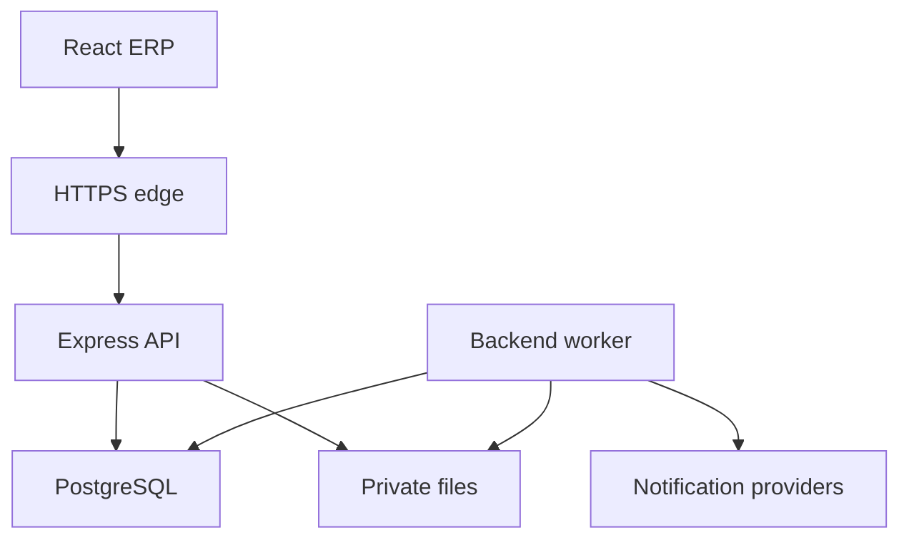

# Fire Safety — Architecture

Version: 1.0 · 2026-10-08 · Status: design, not a source-code audit or installed repository

## 1. Architecture decision

Create a fresh `fire-safety` repository using reviewed Prem Electronics starter patterns and improved permissions, audit, revisions and worker reliability. No starter source/package lockfile has been inspected in this task. Copy infrastructure selectively; never copy its data, secrets, product semantics or broad admin/customer permissions.

Use a modular monolith: React SPA, one feature-organized Express API, one PostgreSQL database, private file storage, and one separately supervised worker from the backend codebase. Single company; branch/project membership is authorization scope, not SaaS tenancy. No microservices, Kubernetes, Redis or independent search service initially.



API and worker run the same domain services. Provider calls happen after database commit via durable jobs. API/worker/storage are adapter boundaries, not additional business modules.

## 2. Stack and compatibility

| Layer | Choice | Usage |
| --- | --- | --- |
| Frontend | React 19.x, Vite, strict TypeScript | Client-rendered ERP; pin supported compatible patch versions at setup |
| Router | React Router | Authenticated layouts, lazy feature routes, URL filters |
| Server state | TanStack Query v5 object API | Typed `queryOptions`, `useQuery`, `useMutation`, precise invalidation |
| UI state | Jotai | Theme/sidebar/UI preferences; no duplicated business cache |
| HTTP | Axios | Shared credentialled client, AbortSignal, bounded refresh/error handling |
| Forms | React Hook Form, Zod resolver | Conditional forms and line-item editors |
| Components | shadcn/ui, Radix base, Tailwind | User preset and exact tokens in design.md |
| Icons / tables / charts | Preset icon library, TanStack Table, Recharts when needed | Keep preset choices; server tables; real scoped metrics |
| API runtime | Supported Node LTS, Express, TypeScript, ESM | Pin runtime after compatibility check; no claim of installed versions |
| Persistence | PostgreSQL, pg, Drizzle, drizzle-kit | Typed SQL, pooling, reviewed versioned migrations |
| Validation / decimals | Zod, decimal.js or reviewed equivalent | Request/env/job contracts, exact quantities/currency |
| Sessions | Reviewed JWT/cookie pattern, bcrypt | Revocable database sessions, secure cookie and CSRF/origin controls |
| Middleware | Helmet, CORS, rate limiting, cookie parser | Deliberate HTTP and authentication configuration |
| Files | Multer + private object-storage adapter | Controlled upload transport; durable storage separate |
| Notifications | Nodemailer + React Email; provider adapters for WhatsApp/SMS | Versioned internal notification templates and job delivery |
| Jobs | PostgreSQL outbox/jobs + worker process | Recurrence, retries, leases and visible failures |
| Documents | Controlled HTML-to-PDF renderer selected at setup | Evaluate on target host; fixed snapshots/templates |
| Imports | Maintained XLSX reader selected after package review | Stream/stage/limit workbook data; CSV can be supported too |
| Quality | Existing compatible lint/test tools; Vitest, Supertest, Playwright where absent | Critical domain/API/browser journeys |

React modern features are optional tools, not migration goals. `useActionState` may simplify a small form action; complex BOQ/PO forms stay in React Hook Form. Pick one mutation owner: an action can call `mutateAsync`, but do not duplicate pending/error state machines. `Activity` is optional for measured benefit preserving tabs; require installed React support (introduced in 19.2), disable unnecessary hidden queries and keep authorization outside component visibility. Hidden content is not an access boundary. `useTransition`/deferred rendering may improve expensive filters. The SPA does not acquire Server Functions merely by adopting React 19; no React Server Components architecture is required.

Use supported current APIs verified against pinned dependencies. Do not replace TanStack Query with React effects, `use`, or a new framework solely because it is newer. No dependency version, build success or feature implementation is asserted by this documentation.

## 3. Repository layout

```text
fire-safety/
  prd.md
  architechture.md
  rules.md
  phase.md
  design.md
  memory.md
  client/
    src/app/                   providers, routes, bootstrap
    src/api/                   Axios, errors, API contracts
    src/features/              identity, crm, engineering, projects, procurement...
    src/components/ui/         generated shadcn components
    src/components/shared/     server table, line editor, files, approval panel
    src/components/layout/     shell, desktop sidebar, mobile drawer
    src/store/                 local UI atoms
    src/styles/                theme and print styles
  server/
    src/app.ts                 configure Express, no listener
    src/server.ts              startup and graceful shutdown
    src/worker.ts              real supervised job runner
    src/config/                validated environment
    src/core/                  errors, actor context, guards, logging
    src/infrastructure/        database, storage, mail, jobs, PDF, providers
    src/modules/               feature domain modules
    drizzle/                   migrations and metadata
    tests/                     isolated PostgreSQL integration fixtures
  docs/                        ERD, policy matrix, API and runbooks
  scripts/                     non-destructive seeds and maintenance
```

Root npm workspaces may coordinate `client`/`server`; keep the familiar structure. A shared contracts package is optional after real duplication appears. No empty future modules/routes pretending to be implemented.

Within a nontrivial module use `*.routes.ts`, `*.controller.ts`, `*.service.ts`, `*.repository.ts`, `*.schema.ts`, `*.policy.ts`. Routes apply middleware; controllers map validated HTTP input/output; services enforce scope/workflow/transactions; repositories own SQL and accept `db` or `tx`; policy helpers decide authorized actions. Cross-module orchestration invokes explicit services and avoids cycles. Jobs reuse those services.

## 4. Modules and boundaries

| Module | Owned records / boundary |
| --- | --- |
| Identity / organization | Users, sessions, permissions, roles, branches, assignments |
| Masters | Customers/contacts/sites, vendors, items/categories/units, later warehouses |
| CRM | Leads, opportunities, activities, membership and recurrence rules |
| Engineering | Design jobs/packages, drawings, revisions, BOQ, estimate, pilot quotation workflow |
| Projects | Minimal register/membership/baselines in pilot; planning/execution later |
| Procurement | Requisitions, RFQ/offers, comparisons, POs/amendments, receipts/inspection |
| Documents / approvals / audit | Private versioned bytes/links, policy versions, decisions, append-only events |
| Notifications | Durable outbox/jobs, in-app delivery and external delivery records |
| Inventory | Later authoritative stock documents/ledger, balances and reservations |
| Quality / handover / finance | Later tests/evidence and commercial accounting records |
| Reporting / import | Scoped read models and staged import runs; no direct bypass writes |

Engineering decides specification approval; purchasing cannot silently substitute approved items. Procurement owns receipt quantities. Later inventory posting references a stable receipt line and posts exactly once; purchasing does not directly edit arbitrary stock balances. Finance does not change technical BOQ quantities to match payment methods.

## 5. Persistence model

| Phase | Tables (logical names; finalize in ERD) |
| --- | --- |
| Foundation | companies, branches, users, employees, auth_sessions, roles, permissions, role_permissions, user_role_assignments, scoped_grants, document_counters |
| Foundation shared | documents, document_versions, explicit_document_links, approval_policy_versions, approval_requests, approval_steps, approval_actions, audit_logs, outbox_jobs, notifications, notification_deliveries, idempotency_records, import_runs, import_rows |
| Masters / CRM | customers, customer_contacts, customer_addresses, sites, vendors, vendor_contacts, items, item_categories, units, leads, opportunities, opportunity_members, activities, reminder_rules, reminder_occurrences |
| Engineering | design_jobs, design_job_members, design_packages, design_package_revisions, drawings, drawing_revisions, design_customer_decisions, boq_revisions, boq_lines, estimate_revisions, estimate_lines, quotations, quotation_revisions, quotation_lines, customer_orders |
| Project pilot | projects, project_members, project_design_baselines, project_commercial_baselines, project_payment_plans |
| Purchasing | requisitions, requisition_lines, rfqs, rfq_lines, vendor_offers, vendor_offer_lines, purchase_comparisons, selection_decisions, purchase_orders, purchase_order_revisions, purchase_order_lines, goods_receipts, goods_receipt_lines, receipt_inspections, supplier_returns |
| Inventory later | warehouses, stock_locations, stock_documents, stock_document_lines, stock_ledger_entries, stock_balances, stock_reservations, reservation_allocations, stock_transfers, item_batches, item_serials |
| Execution later | project_tasks, milestones, daily_reports, report_revisions, material_consumption_links, delays, variations, expenses |
| Quality later | checklist_templates, inspections, test_reports, punch_items, handover_requirements, handover_evidence |
| Finance later | invoices, invoice_lines, receipts, receipt_allocations, vendor_bills, vendor_payments, credit_notes, accounting_export_runs; ledger tables only after accounting scope approval |

Pilot project creation has nullable customer order/accepted quotation. A required immutable design baseline references exact customer-approved package/BOQ. Commercial baseline is recorded independently when accepted later. A design authorization date, actual start date and commercial acceptance date are separate fields.

Use UUID IDs and separate human-readable counters, unique per company/type/period. Default display format `FS-<TYPE>-<YYYY>-<000001>`; provisional calendar-year numbering, official production format remains open. Revisions append `R02`; atomic sequence/counter allocation, never `MAX()+1`. Cancelled numbers are retained.

FKs ensure valid line/document/project relationships. Explicit attachment link tables protect critical references; generic entity-type/ID pairs alone do not provide relational integrity. JSONB is suitable for snapshots/checklist answers, not primary quote/PO line or receipt allocation storage.

Timestamps for instants are timezone-aware and stored in UTC; business date fields and reminder timezone are explicit. Default timezone Asia/Kolkata. Default INR is configurable, never infer taxes. Use NUMERIC(18,2) for final money and NUMERIC(18,4) or appropriate precision for rates/quantities; exact intermediate decimal calculations and configured rounding. API decimals are strings. Payment plans reference full commercial basis, cash percentage and remainder; actual receipts are later separate records, not an assumed percentage-derived cash balance.

Editable aggregates have `row_version`, actor and timestamps. Submitted/issued revisions freeze their rows and snapshots. Deactivate referenced masters, restrict deletion, reverse posted records. Index scope+status+date, FKs, normalized contact search and document number. Measure before adding specialized infrastructure.

## 6. Transactions and concurrency

Create project under a transaction with design approval checks, permitted actor, unique opportunity/project rule, membership, exact design baseline, audit and idempotency result. It must work with quotation still pending. An idempotency retry returns the original project; a conflicting payload returns 409.

Submit/approve reads and compares the exact revision, `expectedVersion`, actor assignment, policy snapshot and active approval step within a transaction. No self-approval, including delegation. If the approval queue has no valid approver, fail with configuration requirement.

Receipt creation locks relevant PO-line aggregates, validates outstanding received quantities and approved excess/substitutions, writes lines/inspection/audit/outbox and idempotency in one transaction. Separate delivered, accepted, rejected and returned quantities avoid treating rejected deliveries as usable stock. Changing inspection does not create another receipt.

Later stock posting locks balance/reservation/source rows in consistent order; eligibility check is in transaction, not a prior unlocked read. Unique source-line posting keys prevent pilot receipts from being posted twice during inventory rollout. Choose an explicit cutover: post only eligible verified historical receipts or establish opening balances; never both for the same stock.

Repositories must use the transaction connection throughout. Short transactions exclude email/PDF/storage network calls. Handle stale edits with 409, bounded retries for recognized database concurrency errors, and operation-level idempotency for irreversible effects.

## 7. API contracts

REST `/api/v1` remains the default; no new query protocol is necessary. Representative routes:

| Method/path | Purpose |
| --- | --- |
| GET /auth/me | Current user, effective permissions/scopes |
| POST /auth/login, /auth/logout, /auth/refresh | Revocable sessions and rotation |
| POST /auth/password-reset/request, /confirm | Rate-limited token reset |
| GET/POST /crm/leads/:leadId/activities | Scoped immutable call/meeting/note timeline |
| GET/POST /crm/leads/:leadId/reminders | Scoped reminder rule and first occurrence |
| GET /crm/reminders; POST /crm/reminders/:id/complete | Current-assignee queue and versioned completion |
| GET/POST /crm/leads/:leadId/attachments | Scoped private attachment metadata/upload |
| GET /crm/leads/:leadId/attachments/:attachmentId/download | Reauthorize lead scope before private streaming |
| POST /leads/:id/authorize-design | Free-design authorization, not award |
| POST /design-package-revisions/:id/submit | Freeze/review exact package |
| POST /design-package-revisions/:id/customer-decisions | Sales records evidence and customer decision |
| POST /design-package-revisions/:id/start-project | Project creation from approved design; commercial award optional |
| POST /quotation-revisions/:id/submit, /issue, /accept | Explicit commercial transitions |
| POST /approval-requests/:id/approve, /return, /reject | Authorized revision-bound decisions |
| POST /purchase-comparisons/:id/select | Supplier choice + justified exceptions |
| POST /purchase-order-revisions/:id/submit, /issue | Purchase review and immutable issue |
| POST /purchase-orders/:id/goods-receipts | Partial delivery with PO-line references |
| POST /goods-receipts/:id/inspect | Acceptance/rejection by assigned reviewer |
| GET /search | Scope and field-filtered metadata search |
| GET /crm/imports/:type/template; POST /crm/imports/:type/stage | Controlled customer/open-lead workbook and server-side staging |
| GET /crm/imports/:id; POST /crm/imports/:id/commit | Creator-scoped preview and restart-safe row-result commit |
| POST /crm/leads/bulk/assign; POST /crm/leads/bulk/reminders | Versioned, scope-checked permitted bulk actions (maximum 100 selected leads) |
| GET /documents/:id/download | Authorization followed by expiring file access |

Collections use bounded page/limit, filter and sort allowlists, stable tie-breaking ID and matching scoped total queries. Default page size 20, limit cap 100. Query keys include identity/scope/filter/pagination. Service derives actor/company from authenticated context, not user-supplied ownership.

Implemented CRM reminder recurrence is occurrence-driven: a transaction creates the rule, first occurrence and due outbox job; after a due job is handled, the worker transactionally inserts the next daily/weekly/monthly occurrence plus a unique deduplicated job. The in-app occurrence is the durable baseline; disabled external providers are never reported delivered. Implemented lead attachments use Multer disk storage with generated names, PDF/JPEG/PNG allowlisting, a 20 MiB cap and SHA-256 metadata. Storage names remain server-private and every metadata/download request first proves access to the parent lead.

Proposed envelope: success `{ data, meta?, requestId }`; error `{ error: { code, message, fieldErrors?, missingRequirements? }, requestId }`. Use 400 malformed, 401 unauthenticated, 403 forbidden, 404 undisclosed/unavailable, 409 version/transition/idempotency conflict, 422 validation. Do not leak SQL/stack traces. `allowedActions` improves UI but server rechecks on execution.

### Query API example (illustrative contract)

```ts
import { queryOptions } from '@tanstack/react-query';

export const projectQueries = {
  detail: (sessionKey: string, projectId: string) => queryOptions({
    queryKey: ['session', sessionKey, 'projects', 'detail', projectId],
    queryFn: async ({ signal }) => {
      const response = await api.get<ProjectEnvelope>(
        `/projects/${projectId}`, { signal },
      );
      return response.data.data;
    },
    staleTime: 30_000,
  }),
};
```

`api` and `ProjectEnvelope` represent the shared Axios client and validated DTO. Never use auth tokens in cache keys. Session key is an opaque nonsecret identity/version key. Branch UI filter is not authorization. Mutations explicitly invalidate affected lists/details/queues; financial/stock/approval actions wait for server success. Clear/cancel sensitive queries and unmount preserved tabs on logout/revocation/identity change. Do not persist business caches in browser storage by default.

## 8. Sessions, documents and imports

Secure HttpOnly cookies, HTTPS, intentional SameSite/CSRF/origin policy and bounded refresh retries. Every request checks session revocation and effective permissions, so leaving employees lose access immediately even if their JWT has not expired. Password reset uses hashed short-lived single-use tokens; reset/block revokes affected sessions. Redact credentials, sensitive financial data and private URLs in logs.

Files use private keys per immutable version, metadata/checksum/type/size, uploader, readiness state and explicit record links. Default limits: PDF/image 20 MiB each, CAD 100 MiB each; the implemented P2 customer/open-lead Excel import is capped at 5 MiB and 500 non-empty rows. Validate content and extensions; original name is display-only. CAD is download-only; PDFs are rendered in a constrained preview. No arbitrary active HTML/SVG/archive/executable previews. Signed links are short-lived; immediate revocation stops new links, existing links have bounded expiry. Objects become attached only after authorized finalize; abandoned cleanup checks state before deletion.

The P2 importer stages up to 500 customer or open-lead rows, validates headers/content/references/permissions/duplicates on the server, rejects formulas, previews errors/warnings and commits only valid rows. The original `.xlsx` is retained privately with checksum metadata. Each record creation and its row result commit in the same transaction; a versioned batch claim prevents concurrent commit, completed rows are skipped on recovery, and failed/invalid rows remain visible. The whole workbook is not described as atomic. Future larger imports require measured chunk limits and worker execution. Protect spreadsheet exports against formula injection.

## 9. Jobs and provider boundaries

Outbox/job fields: type/versioned payload, dedup key, due time, attempts, status, lease owner/expiry, safe last error and result timestamps. Worker claims with database locks/leases, recovers expired leases, retries with backoff and presents final failures for authorized retry. Recurring reminders materialize timezone-aware deduplicated occurrences; no process-only timers.

Record in-app notification separately from each channel delivery. Persist queued/sent/delivered/failed/unknown according to provider evidence. SMTP acceptance is not mailbox delivery. Provider callbacks authenticate and deduplicate events. Retry policies account for uncertain external sends; no exactly-once promise. Internal notifications go to authorized assignees/approvers. Customer/vendor sends require an explicit user action and resolved recipient, even though those parties have no login.

## 10. Deployment and operations

Hosting/provider selections remain open. Provisional topology: same-origin HTTPS reverse proxy, static Vite build, supervised API and worker, PostgreSQL with connection pooling/backups, private S3-compatible storage and SMTP. Local Docker Compose can provide PostgreSQL and test mail. Keep separate local/staging/production secrets/data. Stateless/serverless hosting must have a separately supported worker/scheduler; an unattended in-process interval is insufficient.

Environment contracts: `NODE_ENV`, `PORT`, `DATABASE_URL`, `APP_ORIGIN`, JWT/session secrets, `BUSINESS_TIMEZONE`, `STORAGE_DRIVER`, storage bucket/endpoint/region/credentials, SMTP transport/from, optional enabled channel/provider settings. Validate required values at startup and conditional values when channel is enabled. `.env.example` has placeholders only; never put secrets in Vite variables.

CI installs lockfiles, typechecks, lints, builds, runs relevant isolated domain/API tests, and checks migrations. One controlled migration job deploys reviewed SQL; no automatic production schema push. Health distinguishes live process from ready database/provider dependencies. Monitor API errors, permission failures, worker lag, failed jobs, storage operations and later stock reconciliation.

Pilot requires database+document backup and an actual restore exercise. RPO/RTO, hosting capacity and retention have no company-approved numbers yet. Demo load is the provisional fixture in prd.md, not a service-level promise. Runbooks document restore, user departure, failed deliveries, import recovery and deployment rollback.

## 11. Verified documentation references

Official references consulted 2026-10-08; installed package compatibility must still be checked during repository setup.

- [React useActionState](https://react.dev/reference/react/useActionState): optional form action state; this design does not require Server Functions.
- [React Activity](https://react.dev/reference/react/Activity): optional visibility/state preservation, not authorization.
- [TanStack queryOptions](https://tanstack.com/query/latest/docs/framework/react/reference/functions/queryOptions): share typed query definitions across hooks and imperative usage.
- [shadcn CLI](https://ui.shadcn.com/docs/cli) and [Vite setup](https://ui.shadcn.com/docs/installation/vite): preserve the supplied preset/base/template and inspect generated files.

Version-dependent decisions are revisited when the starter is available. The architecture and rules above are project decisions, not claims from those references.
