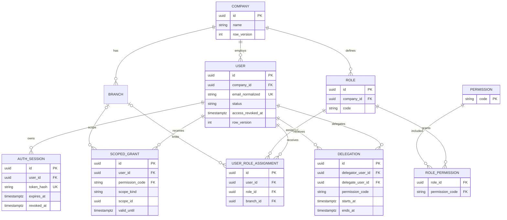
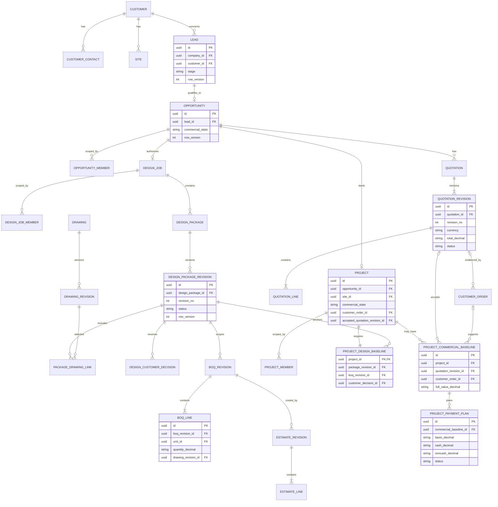
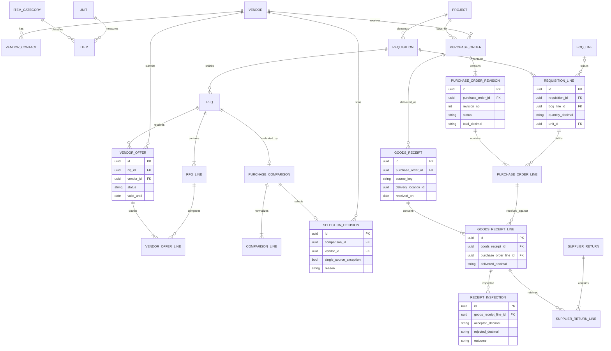
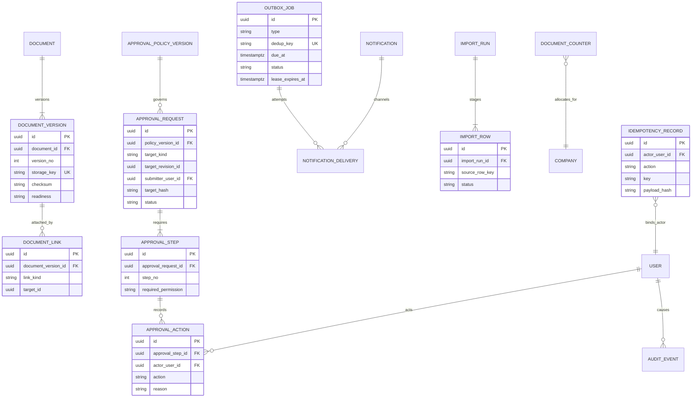

# P0 Logical ERD and Data Dictionary

Prepared: 2026-10-08 · Status: logical design only; no executable schema or migrations

Conventions: pilot primary keys are UUIDs; tenant key is `company_id` even though the first release has one company. Required foreign keys use `NOT NULL`; history-bearing records use restricted deletion. Names below are logical and may be adjusted during reviewed P1 migrations.

## 1. Identity and access

`SCOPED_GRANT.scope_id` is a controlled authorization subject, not a substitute for domain membership FKs. Service policy resolves permitted scope kinds. Unique active user email is per company. Disabling a user revokes all live sessions in the same transaction.

## 2. CRM, engineering and project baseline

`PROJECT.customer_order_id` and `accepted_quotation_revision_id` are nullable at creation. The required design baseline is immutable; later commercial baselines append and never rewrite it. Package-to-drawing links are normalized so evidence identifies exact drawing revisions.

## 3. Procurement

One pilot PO has one vendor and one project. Receipt lines reference exact issued PO lines. Delivered, accepted, rejected and returned values are not collapsed into a single “received” value. No stock ledger or on-hand balance is part of this ERD.

## 4. Shared infrastructure

For critical links, `DOCUMENT_LINK` is implemented with explicit target-specific link tables/FKs (for example, design revision document links and offer document links), not a free-form polymorphic pair. `target_kind/target_revision_id` in approvals is backed by target-specific association or validated constrained registries during physical design.

## 5. Logical data dictionary

### Identity, CRM and engineering

| Entity | Purpose and key fields | Relationships / scope | State, constraints and phase |
| --- | --- | --- | --- |
| `users`, `auth_sessions` | Employee identity; normalized email, status, credential hash; hashed session token, expiry/revocation | Company-owned; sessions belong to user | Unique active email/company; immediate revocation; P1 |
| `roles`, `permissions`, assignments/grants | Candidate capabilities and explicit scope | User-role and role-permission M:N; branch is only one optional limit | Deny by default; time-bounded grants/delegation; P1 |
| `customers`, `contacts`, `sites` | Legal/display customer, people and service/delivery locations | Customer 1:N contacts/sites; visible through permitted work or explicit grant | Deactivate instead of deleting references; normalized duplicate hints; P2 |
| `leads`, `opportunities`, members | Original inquiry and qualified commercial/design context | Lead may qualify once; opportunity has explicit members | Separate stage/commercial state; unique source qualification; P2 |
| `design_jobs`, members | Free-design assignment before project | One initial job/opportunity by default; explicit members | Authorization is not award; P3 |
| `design_packages`, `package_revisions` | Reviewable set of exact drawing versions | Job 1:N package/revisions | Unique `(package_id, revision_no)`; submitted immutable; P3 |
| `drawings`, `drawing_revisions` | Logical drawing and immutable CAD/PDF-associated versions | Package revisions link exact drawing revisions | Original CAD and separate PDF versions; P3 |
| `design_customer_decisions` | Sales-recorded external response/evidence | Exact package/drawing revision and evidence link | Approved/changes requested; recorder is not customer approver; P3 |
| `boq_revisions`, `boq_lines` | Complete technical scope | Exact approved design/drawing references; normalized lines | Full quantities independent of payment; immutable submitted revision; P3 |
| `estimate_revisions`, `estimate_lines` | Permissioned cost build-up | References BOQ revision/lines | Material/labour/etc. separated; exact decimals; P3 |
| `quotations`, revisions/lines | Versioned selling offer | Opportunity and exact design/BOQ; optional later customer order | Approved before issue; immutable issued bytes/snapshot; P3 |
| `customer_orders` | Customer-side commercial award evidence | Optional exact quote revision and document | Never confused with vendor PO; identifiers company-scoped; P3 |
| `projects`, members | Minimal started-project register and scope | Unique initial project/opportunity; explicit members/site | Nullable accepted quote/order at creation; row version; P3 |
| `project_design_baselines` | Required start authorization snapshot | Project 1:1 exact approved package/BOQ/customer decision | Immutable and non-null; P3 |
| `project_commercial_baselines` | Later accepted commercial snapshot | Project 1:N history; optional quote/order | Independent of design baseline; P3 |
| `project_payment_plans` | Forecast split over defined full basis | Belongs to commercial baseline or provisional quote revision | Cash + noncash reconciles to basis; not actual receipt; P3 |

### Procurement

| Entity | Purpose and key fields | Relationships / scope | State, constraints and phase |
| --- | --- | --- | --- |
| `vendors`, contacts | Supplier master and permissioned tax/bank data | Company-owned; visibility by purchasing scope | Deactivate; sensitive fields separately granted; P2/P4 |
| `items`, categories, units | Specification and measurement masters | BOQ/requisition/offer/PO line FKs | Stable unit codes; conversions explicit later; P2/P4 |
| `requisitions`, lines | Authorized project demand | Project; lines trace BOQ or justified extra | Full required quantity/location/date; versioned; P4 |
| `rfqs`, lines | Common request basis | Requisition and invited vendors | Exact comparable line basis; P4 |
| `vendor_offers`, lines | Supplier response and commercial/spec details | Vendor + RFQ; offer lines map RFQ lines | Validity/status; immutable captured offer version; P4 |
| `purchase_comparisons`, lines | Normalized comparison snapshot | RFQ/offers | Currency/unit/tax/freight assumptions explicit; P4 |
| `selection_decisions` | Winning supplier and exception/reason | Exact comparison and vendor | Two-offer default; non-lowest permitted; exact approval target; P4 |
| `purchase_orders`, revisions/lines | Vendor instruction | One project/vendor; trace requisition lines | Every revision reviewed; issued immutable; unique number/revision; P4 |
| `goods_receipts`, lines | Physical delivery occurrence | PO and exact PO lines; source operation key | Unique source/idempotency; transactional outstanding limit; P4 |
| `receipt_inspections` | Accepted/rejected technical outcome | Exact receipt line and different reviewer | Accepted + rejected ≤ delivered after returns/corrections policy; P4 |
| `supplier_returns`, lines | Quantity returned to supplier | Exact receipt line and evidence | Cannot exceed eligible delivered/rejected balance; P4 |

### Shared infrastructure

| Entity | Purpose and key fields | Relationships / scope | State, constraints and phase |
| --- | --- | --- | --- |
| `documents`, versions, explicit links | Private immutable file metadata/bytes | Target-specific FK link tables | Unique storage key/checksum; ready/quarantined; P2 onward |
| `approval_policy_versions` | Frozen routing/rule definition | Company + record/action type | Effective range; never mutate used version; P3 |
| `approval_requests`, steps/actions | Revision-bound review history | Exact target revision, submitter, policy; actions by user | No actor=submitter approval; one active step; stale hash conflicts; P3 |
| `audit_events` | Append-only material action evidence | Actor/company/record/request ID | No update/delete application path; safe snapshots; P1 onward |
| `outbox_jobs`, notifications/deliveries | Durable work and per-channel evidence | Explicit authorized recipient and target | Dedup, lease/retry/recovery; provider truth states; P2 |
| `idempotency_records` | Repeat-safe operation result | Company/actor/action/key/payload hash | Unique tuple; changed payload conflicts; P1 onward |
| `import_runs`, rows | Staged mapping/validation/commit | Uploader scope and stable source-row key | Preview required; per-row results; unique restart identity; P2/P4 |
| `document_counters` | Atomic human number allocation | Company/type/period | Unique counter row and final number; never `MAX()+1`; P1 |

## 6. Physical-design invariants

- Database numeric columns store final money as an initially proposed `NUMERIC(18,2)` and quantities/rates as `NUMERIC(18,4)` or reviewed domain precision. Services use exact decimal arithmetic. APIs accept and return canonical decimal **strings**; JSON numbers are not authoritative.
- Instants use timezone-aware timestamps stored in UTC. Business dates use `DATE`; recurrence stores an IANA timezone (default `Asia/Kolkata`). Never convert a business date through UTC as an instant.
- Editable aggregates have integer `row_version`; updates require `expectedVersion` and atomically increment it. Submitted/issued revisions are insert-only successors.
- Unique business/source constraints include initial project per opportunity, revision number per parent, document number per company/type/period, receipt source operation, outbox dedup key and import source-row identity. Idempotency additionally binds company, actor, action, key and payload hash.
- Counter allocation and business write occur atomically. Cancelled numbers remain reserved. Production formats, tax and fiscal periods remain company inputs.
- JSON snapshots preserve approval policies, rendered-document inputs and comparison assumptions. Normalized relational lines remain authoritative for BOQ, quotations, offers, POs and receipts.
- P6 inventory will reference an eligible receipt line once through a unique posting key. It is outside this pilot schema; no receipt is represented as stock. P9 actual financial receipts are also outside the pilot; payment plans remain forecasts.
